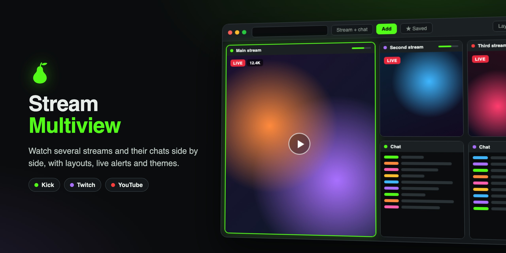

<p align="center"></p>

# 🍐 Stream Multiview

A desktop app for watching **Kick, Twitch and YouTube** streams and chats side by side, with custom layouts, live alerts, a game focus mode and color themes.

  

---

## Features

**Watch everything at once**
- Kick, Twitch and YouTube streams and chats, plus regular YouTube videos
- Drag, resize and snap windows anywhere, or let a layout arrange them
- Layouts: **Focus view**, **Game focus**, **Columns**, **Chat focus**, **Auto** and **Tile**
- Save your own named layouts and switch between them from a dropdown
- Every window's name is a dropdown, so you can swap any two streams or chats

**Switch control**
- One panel for every stream: play/pause, mute, volume, refresh, a live mini preview and remove
- Click a name to make it the big stream, or drag names onto each other to swap them
- Dock it, float it anywhere in the window, or pop it out into its own window (even on another monitor)

**Gaming**
- **Game focus** layout: your game takes the big area and streams and chats sit on the side
- **Put a game here** (Windows): moves your game's real window into the game area, where you play it as normal
- See-through game area, plus "Show a window" to put a stream or another app's window there instead

**Other apps' windows**
- Show any window (such as a Discord pop-out call) as a live picture inside the app
- These windows appear in the switch control and can be made the big one

**Saved channels and alerts**
- Saved list with Kick / Twitch / YouTube tabs, with live channels listed first
- Desktop notifications when saved channels go live, and optional auto-open when they do
- **Import follows** from Kick, Twitch and YouTube (and unfollow Kick channels right from that list)
- **Streamer profiles**: search your saved streamers and open a profile for each one: what the site says (picture, about, followers, links, the live stream), plus a live history, a "when they usually stream" chart, usual start time, average length and viewers that the app records from its live checks, with Kick and Twitch past broadcasts filling the gaps. Notes, tags, nicknames, favourites, and **Unfollow on Kick**
- Alerts when someone @mentions you or replies to you in Kick or Twitch chat: that chat window lights up (and can get stronger until you look), with a sound and desktop notification of your choice
- **Spam alerts for moderators** (off by default): in chats you moderate, promo-bot messages are tagged "likely spam" and the chat window lights up. Nothing is hidden or removed.

**Chrome extensions**
- Install from the **Chrome Web Store** (browse it in the app and click **Add to Stream Multiview**), from a store link, or from an unpacked folder
- Switch each one on per site and per window type (Kick / Twitch / YouTube × streams / chats) in Settings › Extensions
- Each stream and chat window has Extensions in its ⋯ menu: the extensions on in it, their popups and options, and switching one on or off for just that stream
- Extensions that only change pages (like BetterTTV) work well. Some Chrome features aren't available in the app, so blockers that rely on them (like uBlock Origin Lite) won't block anything; the install dialog says when an extension needs one
- Extensions can read and change the pages they're on, including while you're signed in, so only install ones you trust

**Comfort**
- Undo / redo for window changes (Ctrl+Z / Ctrl+Y)
- Keyboard shortcuts (press **F1**), which you can switch off
- **Colors and themes**: 12 built-in themes, full color customization, and saved custom themes
- Auto-pause streams you can't see, and "pause all except focus" to save bandwidth
- One **Settings** window (gear button, Ctrl+, / ⌘,, or the menu bar) for general options, accounts, alerts, extensions, themes, updates, and the built-in instructions and keyboard shortcuts (**F1**)

**Automatic updates**
- Checks this GitHub repository for new versions, installs them in the background, then asks you to restart
- Settings › Updates: check now, turn automatic updates on or off, and what's new in each version

**Privacy and security**
- One login per platform, kept between launches. Passwords are never stored, only each site's "stay signed in" session.
- Saved logins are **encrypted** with a key tied to your user account (kept by Windows, or by the Keychain on a Mac)
- Optional "Forget my login when I close the app" for each platform
- Each stream player gets its own storage, so volumes and settings don't leak between streams
- Optional "Watch signed in" for each platform: streams play with your login so you watch as your account (uses more memory)

---

## Getting started

### Download (recommended)
Get the latest installer from the [**Releases**](https://github.com/GlowingPear/stream-window-multiview/releases/latest) page:

| System | File | How |
|---|---|---|
| Windows 10/11 | `Stream-Multiview-Setup-<version>.exe` | Run it and follow the steps |
| macOS (Intel and Apple Silicon) | `Stream-Multiview-<version>-mac.dmg` | Open it and drag the app into Applications |

The app isn't code-signed yet, so the first launch shows a warning:
- **Windows** ("Windows protected your PC"): click **More info → Run anyway**.
- **Mac** ("can't be opened" / "Apple could not verify"): open **System Settings → Privacy & Security** and click **Open Anyway**.

Installed copies update themselves from new releases.

### Run from source
Requires [Node.js](https://nodejs.org/) (LTS).
- **Windows:** double-click **`Start Stream Multiview.bat`** (first launch installs the engine, about a minute). Optional: **`Create Desktop Shortcut.bat`**.
- **macOS / Linux:** `./start-mac-linux.sh` (on a Mac the first time: right-click it › Open With › Terminal)
- **Any platform:** `npm install` then `npm start`

Keep the folder where it is after setup: the app runs from it. Coming from Kick Multiview? Your logins, saved channels and layouts carry over; copy the old folder's `node_modules` into the new one first to skip the engine install.

> When running from source, always start the app with the launcher, the shortcut or `npm start`. They run `src/harden.js`, which keeps saved-login encryption switched on. (The installers have it built in.)

### Building the installers yourself
```sh
npm install
npm run dist:win   # on Windows -> dist/Stream-Multiview-Setup-<version>.exe
npm run dist:mac   # on a Mac   -> dist/Stream-Multiview-<version>-mac.dmg
```

## Adding streams

Paste any of these into the box at the top and press Enter:

| Platform | Examples |
|---|---|
| Kick | `kick.com/name` or just `name` |
| Twitch | `twitch.tv/name` or `tw:name` |
| YouTube channel | `youtube.com/@name` or `@name` (opens their live stream) |
| YouTube video | any `watch?v=`, `youtu.be/`, `/live/` or `/shorts/` link |

---

## Keyboard shortcuts (highlights)

| Key | Action |
|---|---|
| `F1` / `?` | Help and the full shortcut list |
| `Ctrl+Z` / `Ctrl+Y` | Undo / redo |
| `F` / `G` / `C` / `T` | Focus view / Game focus / Columns / Tile |
| `1`–`9` | Make that stream the big one |
| `←` `→` | Previous / next stream big |
| `M` / `Space` / `R` | Mute / pause / refresh the big stream |
| `S` | Switch control on / off |
| `W` | Show another app's window |

All shortcuts can be switched off in **Help › Keyboard shortcuts**.

---

## Contributing and releases

**Making a change:** open a pull request against `main`. Don't change the version number or `CHANGELOG.md` in it. Write the pull request title as one line a user would understand (for example *"Add Hikari theme"*), because titles become the app's "What's new" entries. Every pull request runs the tests, and builds the Windows and Mac installers as a test if it changes anything that goes into them (they appear under the run's **Artifacts**). A red ✗ on the pull request means something broke: open **Details** to see which test.

**Running the tests yourself** (needs Node.js 22 or newer; CI uses the version in `.nvmrc`, which nvm, fnm and Herd switch to for you):

| Command | What it checks | Time |
|---|---|---|
| `npm test` | Updates, the release scripts, login encryption, live checks, streamer profile history and the spam scoring. Needs nothing else installed. | seconds |
| `npm run test:setup` | Run once: installs the test browser (Playwright). It isn't saved as a dependency of the app. | once |
| `npm run test:ui` | The app's page in a headless browser: adding streams, moving and resizing windows, layouts, Columns scrolling, the switch control, Saved channels, your layouts, Game focus, undo/redo, shortcuts, themes, Settings, alerts | ~1 min |
| `npm run test:launch` | Starts the real desktop app with stand-in Kick, Twitch and YouTube pages: start-up, volume and pause, popping streams out, logins, live alerts and notifications, the Import follows dialog, streamer profiles, the menu bar, Settings, updates, showing another app's window, mention and spam alerts in chat windows, and Chrome extensions with a small test extension (needs `npm install`; on Linux without a screen, run it with `xvfb-run -a`) | ~1 min |
| `npm run test:all` | All of the above | |
| `npm run test:coverage` | All of the above, recording which code they run. Prints how much of each file the tests run and writes `coverage/report.md` with the bigger functions no test runs. In CI (which runs it on every pull request and puts the report on the run's summary page) it fails if a file drops below its minimum in `test/coverage-min.json`; on your computer that's only a warning, because some code only runs on Linux, or on Node 22 or newer. | ~2 min |

The tests are in `test/`. When you add a feature, add a test next to the similar ones. Coverage doesn't have to be 100%, but it can't go down: if `npm run test:coverage` says a file is below its minimum, test what you changed. When coverage goes up, raise the minimums in `test/coverage-min.json` to the numbers on the CI run's summary page.

What the tests deliberately don't do, because it needs the real outside world:
- Real Kick, Twitch and YouTube: live checks, Import follows and signing in to the real sites. The tests use stand-in pages and answers; the parsing is unit tested in `test/unit`.
- Downloading and running an update installer (the update checks, notes and buttons are tested).
- Moving a game's window into Game focus: it uses Windows system calls.
- The real list of other windows for "Show another app's window": on a Mac it needs the screen-recording permission. The picker, the picture and its controls are tested with a stand-in window.
- The `npm run dev` and `npm run worktree` developer scripts are only partly tested (their option parsing and checks).

**Working on a change:**

| Command | What it does |
|---|---|
| `npm run worktree -- <branch>` | Creates the branch from the latest `main` in its own folder, `.worktrees/<branch>` (a git worktree; git and the installers leave that folder out), with `npm install` done. Lets you work on several changes at once. |
| `npm run worktree -- --clean` | Removes worktrees and their branches once their pull request is merged (keeps any with uncommitted changes). |
| `npm run dev` | Runs the app from the folder you're in as a separate copy with its own data folder, so it never touches your installed copy's logins and runs next to it. The window title shows the branch. |
| `npm run dev -- --profile <name>` | The same, but keeps its logins and saved channels between runs |
| `npm run dev -- --debug` | Also opens a debugging port on `127.0.0.1`, for test scripts (Playwright) |

Both work on Windows, Mac and Linux, and download the app engine if `npm install` skipped it. Changes to `src/main.js` need a restart of the app; changes to `src/index.html` only **View › Reload everything**.

Pull requests follow the template in `.github/pull_request_template.md`. For anything you can see in the app, add before/after screenshots or a short video, but don't commit them.

**Claude Code:** `.claude/skills/` has skills for this workflow: `start-change` (plan, worktree, before/after captures), `run-dev`, `drive-app` (Playwright helper for checks, screenshots and videos), `open-pr`, `platform-api-probe` (read-only checks of Kick, Twitch and YouTube APIs) and `release-video` (a "what's new" video of everything merged since the last release, with made-up channels).

**Publishing an update** (when one or more pull requests are merged):
1. Go to **Releases → Draft a new release**.
2. **Choose a tag:** type the new version, e.g. `v0.2.11`, and pick *Create new tag on publish*, target **main**. While in beta, raise the last number for each update (`v0.2.10` → `v0.2.11`); raise the middle one only for a big milestone (`v0.3.0`). `v1.0.0` is the first finished release.
3. Click **Generate release notes** (lists the merged pull requests), tidy them if you like, and **Publish release** (leave "pre-release" unticked).

The **Build installers** workflow then sets the version from the tag, adds the notes to `CHANGELOG.md`, commits that to `main`, builds the installers and attaches them to the release. Everyone's app updates itself from there: installed copies download the new installer, copies run from source download the new files.

Notes:
- Create the release from the latest `main`; the workflow stops if the tag points anywhere else.
- **Release key:** `main` is protected (the "Protect main" ruleset: pull requests with passing tests only), and GitHub doesn't let its own Actions token skip that on a personal repository. So the workflow commits the version and changelog with a deploy key:
  1. Make a key pair: `ssh-keygen -t ed25519 -N "" -C "release" -f release_key` (Windows PowerShell, Mac or Linux).
  2. **Settings → Deploy keys → Add deploy key:** title `release`, paste `release_key.pub`, tick **Allow write access**.
  3. **Settings → Secrets and variables → Actions → New repository secret:** name `RELEASE_DEPLOY_KEY`, paste the whole of `release_key` (the file without `.pub`).
  4. **Settings → Rules → Rulesets → Protect main → Bypass list → Add bypass → Deploy keys**, then **Save changes**.
  5. Delete both key files from your computer.

  Without the secret the release stops at its first step and says so.
- Copies that are a git clone (they have a `.git` folder) never update themselves. Use `git pull` there.
- **Mac signing certificate:** the repository secrets `MAC_CERT_P12` (the certificate as base64) and `MAC_CERT_PASSWORD` sign every Mac build with the same self-signed certificate. macOS recognises the app by that signature, so it keeps letting each new version read the saved-login key in the Keychain. Without them, Mac builds are signed ad hoc and Mac users are logged out after every update. Keep the same certificate: a new one counts as a different app once more.

## Project structure

The app's code is in `src/`. The top folder only has the docs, the launchers and the project setup.

| File | What it is |
|---|---|
| `src/main.js` | Electron main process: windows, logins, live checks, notifications, game window placement |
| `src/preload.js` | Safe bridge between the app pages and the main process |
| `src/index.html` | The main app UI: windows, layouts, switch control, menus and themes |
| `src/switcher.html` | The switch control when it's popped out into its own window |
| `src/extensions.js` | Chrome extensions: the installed list, which sessions get which extension, installing and updating (with `electron-chrome-extensions` and `electron-chrome-web-store`) |
| `src/live.js` | Live-status parsing, link parsing and follow import helpers |
| `src/profiles.js` | Streamer profiles: records the streams the live checks see, works out the profile's numbers, reads what the sites say |
| `src/spam.js` | Scores chat messages for spam alerts (used by the app page and the tests) |
| `src/firefox-login.js` | Copies the YouTube/Google login from Firefox for YouTube sign-in |
| `src/updater.js` | Checks GitHub for a newer version, downloads it and installs it safely |
| `src/harden.js` | Turns on Electron's cookie-encryption fuse so saved logins are encrypted |
| `src/signin-preload.js` | Makes Google's sign-in page accept the app |
| `src/icon.ico`, `src/icon.png` | App icons |
| `build/` | Installer setup: the large Mac icon and the hook that turns on login encryption in the installers |
| `scripts/prepare-release.js` | Sets the version from the release tag and adds the release notes to `CHANGELOG.md` |
| `scripts/release-notes.js` | Turns a version's section of `CHANGELOG.md` into release notes |
| `scripts/dev.js`, `scripts/worktree.js`, `scripts/dev-tools.js` | `npm run dev` and `npm run worktree` for developers |
| `.claude/skills/` | Claude Code skills for making a change, running and driving the app, and opening a pull request |
| `.github/pull_request_template.md` | What a pull request description should cover |
| `.github/assets/` | The README's hero image (`hero.jpg`) and the page it's drawn from (`hero.html`) |
| `test/` | Quick tests (`unit/`), UI tests (`ui/`) and the desktop-app launch test (`launch/`) |
| `.github/workflows/build.yml` | On each release: stamps the version and changelog, runs the quick tests, builds the .exe and .dmg installers, attaches them |
| `.github/workflows/test.yml` | Runs the tests on every pull request and every change to `main` |
| `Start Stream Multiview.bat`, `start-mac-linux.sh`, `Create Desktop Shortcut.bat` | Launchers for running from source |
| `INSTRUCTIONS.txt` | How to use every feature (also shown in the app) |
| `CHANGELOG.md` | Version history (also shown in the app) |

---

## Notes and limitations

- **Put a game here** is Windows-only. It works best with games set to **Windowed** mode, and some games refuse to be resized.
- Windows from other apps (like Discord) are shown as a live picture. Interact with them in the real window.
- YouTube sign-in only works through Firefox: Google blocks signing in inside apps, and Chrome and Edge lock their logins so they can't be copied. Sign in to YouTube in Firefox, then use **Copy my login from Firefox** in the app. Watching YouTube doesn't need a login.
- YouTube chats aren't watched for @mentions.
- Chrome extensions: each chat site and each stream keeps its own extension settings. Extensions that need Chrome features the app doesn't have (blocking rules, capturing a page's sound, offscreen documents) only partly work.
- The app depends on how Kick, Twitch and YouTube's websites work today, so a change on their side can break a feature until the app is updated.

---

## Disclaimer

Stream Multiview is an independent project. It is not affiliated with or endorsed by Kick, Twitch, YouTube, Google or Discord. All trademarks belong to their owners.

---

## License

Stream Multiview is free software under the [GNU General Public License v3.0](LICENSE). Versions up to 0.2.20 were released under the MIT License.
