<p align="center"></p>

# 🍐 Stream Multiview

A desktop app for watching **Kick, Twitch and YouTube** streams and chats side by side, with custom layouts, live alerts, a game focus mode and color themes.

  

---

## Features

**Watch everything at once**
- Kick, Twitch and YouTube streams and chats, plus regular YouTube videos
- Drag, resize and snap windows anywhere, or let a layout arrange them
- Layouts: **Focus view**, **Game focus**, **Columns**, **Chat Stage**, **Chat Rail**, **Chat focus**, **Auto** and **Tile**
- Save your own named layouts and switch between them from a dropdown
- Several monitors: for each layout, put its streams, chats and switch control on the monitor you like, with Identify monitors; everything comes back to one monitor when one is unplugged
- Every window's name is a dropdown, so you can swap any two streams or chats
- The toolbar across the top or down the left side (with names, or a slim column of icons that shows the names when you point at it)

**Switch control**
- One panel for every stream: play/pause, mute, volume, refresh, a live mini preview and remove
- Click a name to make it the big stream, or drag names onto each other to swap them
- Dock it, float it anywhere in the window, or pop it out into its own window (even on another monitor)

**Gaming**
- **Game focus** layout: your game takes the big area and streams and chats sit on the side
- **Put a game here** (Windows): moves your game's real window into the game area, where you play it as normal
- See-through game area, plus "Show a window" to put a stream or another app's window there instead

**Other apps' windows**
- Show any window (such as a Discord pop-out call) as a live picture inside the app
- These windows appear in the switch control and can be made the big one

**Channels and alerts**
- One **Channels** box to open a channel (name or link, on Kick, Twitch or YouTube, checked to exist first) or open and save it, and to search your saved channels
- Saved list with Kick / Twitch / YouTube tabs, with live channels listed first
- Desktop notifications when saved channels go live, and optional auto-open when they do
- Suggestions from the channels you follow but haven't saved, as you type in the Channels box (and who's live among them)
- **Import follows** from Kick, Twitch and YouTube (and unfollow Kick channels right from that list)
- **Streamer profiles**: search your saved streamers and open a profile for each one: what the site says (picture, about, followers, links, the live stream), plus a live history, a "when they usually stream" chart, usual start time, average length and viewers that the app records from its live checks, with Kick and Twitch past broadcasts filling the gaps. Notes, tags, nicknames, favourites, and **Unfollow on Kick**
- **Emote preview**: point at an emote in chat to see it bigger with its name, then copy the name or download it
- **Chat over streams** (off by default): each stream's new chat messages over it for a few seconds, also when popped out; a toolbar button switches it, and each stream can turn it off
- **New-message counts** (off by default): a chat out of sight in any layout counts the messages you haven't seen, on its stream's title bar, its row in the switch control, and Chat Stage's strip or Chat Rail's tabs
- **Channel name in chat boxes** (off by default): each chat box says which channel you're typing in, in your own words if you like, instead of "Send a message"
- **Like YouTube streams** from their title bar with your YouTube login, or have them liked automatically once they're playing
- **Right-click menu** in chats and streams: copy, paste, open or copy links, translate selected text to your language, open or save emotes and images
- **Follows raids**: when a Kick or Twitch channel raids another, its stream and chat switch to the raided channel in the same spot
- Alerts when someone @mentions you, replies to you, or writes one of your own words (nicknames) in Kick or Twitch chat, with a searchable history of the last 500: that chat window lights up (and can get stronger until you look), with a sound and desktop notification of your choice
- **Support alerts** (off by default): an alert when someone sends KICKs, bits or a Super Chat, gifts subs, subscribes or raids in, with the smallest amount that alerts for each
- **Spam alerts for moderators** (off by default): in chats you moderate, promo-bot messages are tagged "likely spam" and the chat window lights up. Nothing is hidden or removed.

**Chrome extensions**
- Install from the **Chrome Web Store** (browse it in the app and click **Add to Stream Multiview**), from a store link, or from an unpacked folder
- Switch each one on per site and per window type (Kick / Twitch / YouTube × streams / chats) in Settings › Extensions
- Each stream and chat window has Extensions in its ⋯ menu: the extensions on in it, their popups and options, and switching one on or off for just that stream
- Extensions that only change pages (like BetterTTV) work well. Some Chrome features aren't available in the app, so blockers that rely on them (like uBlock Origin Lite) won't block anything; the install dialog says when an extension needs one
- Extensions can read and change the pages they're on, including while you're signed in, so only install ones you trust

**Connected apps**
- Links with [**Pear Drops**](https://github.com/StreamOrchard/pear-drops), which collects your Kick drops, through [Grapevine](https://github.com/StreamOrchard/grapevine). Switch it on in Settings › Connected apps, in both apps
- Kick credits drop watch time to one stream per account, so while Pear Drops farms, Kick stream players here sign out (chats stay signed in) and sign back in 5 minutes after it stops
- Pear Drops is told whether the Kick players are signed in, so it can say when they're taking its credit
- Optional: what Pear Drops is farming in the toolbar, with the drop's progress and rewards; click it to open Pear Drops

**Comfort**
- Undo / redo for window changes (Ctrl+Z / Ctrl+Y)
- Keyboard shortcuts (press **F1**), which you can switch off
- **Colors and themes**: 12 built-in themes, full color customization, and saved custom themes
- Auto-pause streams you can't see, and "pause all except focus" to save bandwidth
- One **Settings** window (gear button, Ctrl+, / ⌘,, or the menu bar) for general options, accounts, alerts, extensions, themes, updates, and the built-in **Guide** (searchable, with a **?** on every Settings page) and keyboard shortcuts (**F1**)
- **Developer tools** (Settings › Developer): Copy diagnostics for a bug report, an error log, the sites' last answers, and in the chats' right-click menu Copy message HTML, Copy chat HTML and *Why didn't this alert?*

**Automatic updates**
- Checks this GitHub repository for new versions, installs them in the background, then asks you to restart
- Settings › Updates: check now, turn automatic updates on or off, and what's new in each version

**Privacy and security**
- One login per platform, kept between launches. Passwords are never stored, only each site's "stay signed in" session.
- Saved logins are **encrypted** with a key tied to your user account (kept by Windows, or by the Keychain on a Mac)
- Optional "Forget my login when I close the app" for each platform
- Each stream player gets its own storage, so volumes and settings don't leak between streams
- Optional "Watch signed in" for each platform: streams play with your login so you watch as your account (uses more memory)
- Connected apps talk only on this computer, through a private socket that web pages and other computers can't reach. The two apps pair once, with a key kept encrypted like the logins, and never share your login: only whether the Kick players are signed in, your Kick username and the Kick channels open

---

## Install

Download the installer for your computer from the [latest release](https://github.com/GlowingPear/stream-window-multiview/releases/latest), under **Assets**:

| Computer | File |
|---|---|
| **Windows** 10 or 11, 64-bit | `Stream-Multiview-Setup-<version>.exe` |
| **Mac** (Apple silicon or Intel), macOS 13 or newer | `Stream-Multiview-<version>-mac.dmg` |

Linux: run it from source (below).

The app is free, and it isn't signed with a paid Apple or Microsoft certificate yet, so your computer warns you the first time. That's expected:

**Windows**
1. Open the `.exe` you downloaded.
2. If a blue *Windows protected your PC* box appears, click **More info**, then **Run anyway**.
3. Follow the installer. Stream Multiview opens when it's done, and gets a Start menu and desktop shortcut.

**Mac**
1. Open the `.dmg` and drag **Stream Multiview** into **Applications**.
2. Open Stream Multiview from Applications. macOS says it can't check it for malware: click **Done**.
3. Open **System Settings › Privacy & Security**, scroll down to *"Stream Multiview" was blocked* and click **Open Anyway** (and again in the box that follows), then enter your password. You only do this once.
4. If macOS asks to use *Stream Multiview Safe Storage* in your keychain (it can after an update), enter your password and click **Always Allow**. That key encrypts your saved logins.

**Then:**
1. Open **Channels** (top left, or press `N`), type a channel's name or paste a link, and press **Open** (see *Adding streams* below).
2. To chat, log in to Kick, Twitch or YouTube with **Logins** in the toolbar. You log in once per site.

Stream Multiview updates itself: Settings › Updates shows when there's a new version. Installing it closes the app, updates it and opens it again. (On a Mac this needs the app in a folder you can write to, like Applications; otherwise it opens the new disk image to drag in.)

### Run from source

For Linux, or to work on the app. Needs [Node.js](https://nodejs.org) 22.12 or newer (24 recommended).
- **Windows:** double-click **`Start Stream Multiview.bat`** (the first launch installs the app engine, about a minute). Optional: **`Create Desktop Shortcut.bat`**.
- **macOS / Linux:** `./start-mac-linux.sh` (on a Mac the first time: right-click it › Open With › Terminal)
- **Any platform:** `npm install` then `npm start`

Keep the folder where it is after setup: the app runs from it. Coming from Kick Multiview? Your logins, saved channels and layouts carry over; copy the old folder's `node_modules` into the new one first to skip the engine install.

> When running from source, always start the app with the launcher, the shortcut or `npm start`. They run `src/main/harden.js`, which keeps saved-login encryption switched on. (The installers have it built in.)

### Building the installers yourself
```sh
npm install
npm run dist:win   # on Windows -> dist/Stream-Multiview-Setup-<version>.exe
npm run dist:mac   # on a Mac   -> dist/Stream-Multiview-<version>-mac.dmg (and -mac.zip, used by in-app updates)
```

## Adding streams

Open **Channels** (top left, or press `N`), paste or type any of these into its box and press Enter:

| Platform | Examples |
|---|---|
| Kick | `kick.com/name` or just `name` |
| Twitch | `twitch.tv/name` or `tw:name` |
| YouTube channel | `youtube.com/@name` or `@name` (opens their live stream) |
| YouTube video | any `watch?v=`, `youtu.be/`, `/live/` or `/shorts/` link |

---

## Keyboard shortcuts (highlights)

| Key | Action |
|---|---|
| `F1` / `?` | Help and the full shortcut list |
| `Ctrl+Z` / `Ctrl+Y` | Undo / redo |
| `F` / `G` / `C` / `K` / `T` | Focus view / Game focus / Columns / Chat Stage / Tile |
| `Shift+K` / `Shift+C` | Chat Rail / Chat focus |
| `1`–`9` | Make that stream the big one |
| `←` `→` | Previous / next stream: big in Focus view, on the stage in Chat Stage, its chat in Chat Rail, picked in other layouts (sound can follow) |
| `M` / `Space` / `R` | Mute / pause / refresh the big stream |
| `S` | Switch control on / off |
| `Z` / `Shift+Z` | Blow up chat on click on / off / blow up the last chat you clicked now |
| `W` | Show another app's window |

All shortcuts can be switched off in **Help › Keyboard shortcuts**.

---

## Reporting a problem

Open an issue with **Something isn't working**. In the app, Settings › Developer › **Copy diagnostics** copies what's needed (the version, your system, the open windows, recent errors; logins, cookies and keys are left out): paste it in the issue's **Diagnostics** box. See [Reporting a problem](docs/guide/reporting-a-problem.md) for a chat that looks wrong, a message that didn't alert, or a stuck stream.

## Contributing and releases

**Making a change:** open a pull request against `main`. Don't change the version number or `CHANGELOG.md` in it. Write the pull request title as one line a user would understand (for example *"Add Hikari theme"*), because titles become the app's "What's new" entries. Every pull request runs the tests, and builds the Windows and Mac installers as a test if it changes anything that goes into them (they appear under the run's **Artifacts**). A red ✗ on the pull request means something broke: open **Details** to see which test.

**Running the tests yourself** (needs Node.js 22 or newer; CI uses the version in `.nvmrc`, which nvm, fnm and Herd switch to for you):

| Command | What it checks | Time |
|---|---|---|
| `npm test` | Updates, the release scripts, login encryption, live checks, streamer profile history, the spam scoring and the link with Pear Drops. Needs nothing else installed. | seconds |
| `npm run test:setup` | Run once: installs the test browser (Playwright). It isn't saved as a dependency of the app. | once |
| `npm run test:ui` | The app's page in a headless browser: adding streams, moving and resizing windows, layouts, Columns scrolling, the switch control, Saved channels, your layouts, Game focus, undo/redo, shortcuts, themes, Settings, alerts | ~1 min |
| `npm run test:launch` | Starts the real desktop app with stand-in Kick, Twitch and YouTube pages: start-up, volume and pause, popping streams out, logins, live alerts and notifications, the Import follows dialog, streamer profiles, the menu bar, Settings, updates, showing another app's window, mention and spam alerts in chat windows, Chrome extensions with a small test extension, and Connected apps with Grapevine's stand-in Pear Drops (needs `npm install`; on Linux without a screen, run it with `xvfb-run -a`) | ~1 min |
| `npm run test:launch:hidden` | The same, but the app's windows are invisible and never take your keyboard or focus, so you can keep working while it runs. There are no desktop notifications either. Clicks and typing still reach the app, because Playwright sends them straight to its pages. `npm run test:coverage:hidden` does the same for the coverage run. Linux can't make windows see-through, so use `xvfb-run -a` there. | ~1 min |
| `npm run test:all` | All of the above | |
| `npm run test:coverage` | All of the above, recording which code they run. Prints how much of each file the tests run and writes `coverage/report.md` with the bigger functions no test runs. In CI (which runs it on every pull request and puts the report on the run's summary page) it fails if a file drops below its minimum in `test/coverage-min.json`; on your computer that's only a warning, because some code only runs on Linux, or on Node 22 or newer. | ~2 min |

**The guide** (`docs/guide/`, shown in the app as Settings › Guide): one Markdown page per topic. When a change adds or changes something people use, update its page (or add one) in the same pull request. Each page starts with a short header: `title`, `group` (start, watching, chat, alerts, sites, app, help), `icon` (a name from `src/page/shared/icons.js`), `lede` (one line), `settings` (the Settings page it belongs to: its **?** opens this page), `show` (what **Show me** points at), `words` (to find it by), `related` and `order`. In the text, "Settings › Chat" becomes a button to that page and `[a page](other.md)` a link to it. `docs/guide/README.md` lists every page, in order, for GitHub; `npm test` checks the two agree.

**No system pop-ups in the app's pages.** They ignore the theme, and on a Mac they sit above every app and take the keyboard, even from the launch tests' invisible windows. Dropdowns (`<select>`) open the app's own list by themselves (`src/page/shared/dropdown.js`). For questions and messages, use the app's own `ask()` (`src/page/shared/ask.js`) and `flash()` (`src/page/shared/flash.js`), not `alert()`, `confirm()` or `prompt()`. Also no `<datalist>`, date or time inputs, system menus (`Menu.popup`) or message boxes (`dialog.showMessageBox`). File pickers are the exception, and so are the colour pickers for now. `npm test` fails if one of these slips in (`test/unit/no-system-popups.test.js`).

**What the app lets in** (`src/main/guard.js`, issue #45). The app shows pages from other sites and holds your logins, so:
- A message handler for the page goes through `appIpc` (the main and streams windows), `mainIpc` (the main window only: anything that changes updates, logins, extensions or what the app trusts) or `switcherIpc`, never `ipcMain` directly: they only answer the app's own windows. Check every argument.
- What pages may ask for (camera, notifications, opening other apps…) is refused unless it's in `guard.js`'s lists; add to them only what a feature needs.
- Links go to the browser through `openExternal` in `main.js` (http and https only); a window with a login stays on the sites (`keepOnSites`).
- The app's pages have a Content-Security-Policy: no `<script>` in the HTML and no `onclick="…"`-style attributes; code goes in files, handlers in code.
- `SMV_` variables that point the app somewhere else only work in copies run from source.

The tests are in `test/`. When you add a feature, add a test next to the similar ones. Coverage doesn't have to be 100%, but it can't go down: if `npm run test:coverage` says a file is below its minimum, test what you changed. When coverage goes up, raise the minimums in `test/coverage-min.json` to the numbers on the CI run's summary page.

What the tests deliberately don't do, because it needs the real outside world:
- Real Kick, Twitch and YouTube: live checks, Import follows and signing in to the real sites. The tests use stand-in pages and answers; the parsing is unit tested in `test/unit`.
- Downloading and running an update installer (the update checks, notes and buttons are tested).
- Moving a game's window into Game focus: it uses Windows system calls.
- The real list of other windows for "Show another app's window": on a Mac it needs the screen-recording permission. The picker, the picture and its controls are tested with a stand-in window.
- The `npm run dev` and `npm run worktree` developer scripts are only partly tested (their option parsing and checks).

**Working on a change:**

| Command | What it does |
|---|---|
| `npm run worktree -- <branch>` | Creates the branch from the latest `main` in its own folder, `.worktrees/<branch>` (a git worktree; git and the installers leave that folder out), with `npm install` done. Lets you work on several changes at once. |
| `npm run worktree -- --clean` | Removes worktrees and their branches once their pull request is merged (keeps any with uncommitted changes). |
| `npm run dev` | Runs the app from the folder you're in as a separate copy with its own data folder, so it never touches your installed copy's logins and runs next to it. The window title shows the branch. |
| `npm run dev -- --profile <name>` | The same, but keeps its logins and saved channels between runs |
| `npm run dev -- --debug` | Also opens a debugging port on `127.0.0.1`, for test scripts (Playwright) |
| `npm run page-imports` | Updates the import and export lines of the page's modules (`src/page/`) to what their code uses. `npm test` fails when they're out of step |
| `npm run visual-diff` | For a change that shouldn't change how anything looks: captures the page in this folder and in `main` through its panels, menus and layouts, and compares them (pictures, and every element's box and styles). Local only |

Both work on Windows, Mac and Linux, and download the app engine if `npm install` skipped it. Changes to the Electron side (`src/main/`, `src/preload/`) need a restart of the app; changes to the page (`src/index.html` and `src/page/`) only **View › Reload everything**.

Pull requests follow the template in `.github/pull_request_template.md`. For anything you can see in the app, add before/after screenshots or a short video, but don't commit them.

**Claude Code:** `.claude/skills/` has skills for this workflow: `start-change` (plan, worktree, before/after captures), `run-dev`, `drive-app` (Playwright helper for checks, screenshots and videos), `open-pr`, `platform-api-probe` (read-only checks of Kick, Twitch and YouTube APIs) and `release-video` (a "what's new" video of everything merged since the last release, with made-up channels).

**Publishing an update** (when one or more pull requests are merged):
1. Go to **Releases → Draft a new release**.
2. **Choose a tag:** type the new version, e.g. `v0.2.11`, and pick *Create new tag on publish*, target **main**. While in beta, raise the last number for each update (`v0.2.10` → `v0.2.11`); raise the middle one only for a big milestone (`v0.3.0`). `v1.0.0` is the first finished release.
3. Click **Generate release notes** (lists the merged pull requests), tidy them if you like, and **Publish release** (leave "pre-release" unticked).

`package-lock.json` is committed: the tests and the installers install exactly what it lists (`npm ci`), so a release is built from the packages its pull requests were tested with. Adding or updating a dependency with `npm install` updates it too: commit both files.

Dependabot opens weekly pull requests for the npm packages and the GitHub Actions (`.github/dependabot.yml`; all the Actions ones together, in one). Patch and minor updates, and new major versions of Actions, merge themselves once the required checks pass (`.github/workflows/dependabot-automerge.yml`); other majors, and Grapevine past a patch, wait for review. Generated release notes leave them out (`.github/release.yml`).

The **Build installers** workflow then sets the version from the tag, adds the notes to `CHANGELOG.md`, commits that to `main`, builds the installers and attaches them to the release. Everyone's app updates itself from there: installed copies download the new installer, copies run from source download the new files.

Notes:
- Create the release from the latest `main`; the workflow stops if the tag points anywhere else.
- **Release key:** `main` is protected (the "Protect main" ruleset: pull requests with passing tests only), and GitHub doesn't let its own Actions token skip that on a personal repository. So the workflow commits the version and changelog with a deploy key:
  1. Make a key pair: `ssh-keygen -t ed25519 -N "" -C "release" -f release_key` (Windows PowerShell, Mac or Linux).
  2. **Settings → Deploy keys → Add deploy key:** title `release`, paste `release_key.pub`, tick **Allow write access**.
  3. **Settings → Secrets and variables → Actions → New repository secret:** name `RELEASE_DEPLOY_KEY`, paste the whole of `release_key` (the file without `.pub`).
  4. **Settings → Rules → Rulesets → Protect main → Bypass list → Add bypass → Deploy keys**, then **Save changes**.
  5. Delete both key files from your computer.

  Without the secret the release stops at its first step and says so.
- Copies that are a git clone (they have a `.git` folder) never update themselves. Use `git pull` there.
- **Mac signing certificate:** the repository secrets `MAC_CERT_P12` (the certificate as base64) and `MAC_CERT_PASSWORD` sign every Mac build with the same self-signed certificate. macOS recognises the app by that signature, so it keeps letting each new version read the saved-login key in the Keychain. Without them, Mac builds are signed ad hoc and Mac users are logged out after every update. The signature is also how an installed Mac app checks an update before swapping it in: an update is only installed in place when it's signed with the same certificate (otherwise the app opens the disk image instead). Keep the same certificate: a new one counts as a different app once more.

## Project structure

The app's code is in `src/`. The top folder only has the docs, the launchers and the project setup.

| File | What it is |
|---|---|
| `src/main.js` | The app's start file: it only loads `src/main/main.js` (it stays here, with `src/index.html`, for copies that update themselves) |
| `src/main/main.js` | Electron main process: windows, logins, live checks, notifications, game window placement |
| `src/main/` | The rest of the Electron side: `live.js` (live-status, link and follow import parsing), `profiles.js` (streamer profiles: the streams the live checks see, the profile's numbers, what the sites say), `profile-queue.js` (fetching saved channels' profiles in the background), `extensions.js` (Chrome extensions, with `electron-chrome-extensions` and `electron-chrome-web-store`), `emote-lists.js` (new emotes), `context-menu.js` and `translate.js` (the right-click menu, translating chats), `firefox-login.js` (the YouTube login from Firefox), `link.js` (Connected apps: the link with Pear Drops, through `@streamorchard/grapevine`), `updater.js` (updates from GitHub), `harden.js` (Electron's cookie-encryption fuse, so saved logins are encrypted) |
| `src/preload/` | `preload.js`, the safe bridge between the app's pages and the main process (`window.kmv`), and `signin-preload.js`, which makes Google's sign-in page accept the app |
| `src/index.html` | The main app page (also the streams window): its markup, and the CSS and code it loads from `src/page/` |
| `src/page/` | The page's code and CSS, by part of the app: `windows/`, `layout/` (layouts, columns, switch control), `toolbar/`, `panels/` (Channels, the bell, Settings, profiles, help, …), `chat/`, `alerts/`, `platforms/`, `in-site/` (scripts that run inside the Kick, Twitch and YouTube pages), `shared/` (saved settings, icons, messages, the confirm dialog, tooltips) and `styles/base.css`. `app.js` loads them and runs each part's start-up code (its `init()`) in order. How the code there is written: `src/page/README.md` |
| `src/switcher.html` | The switch control when it's popped out into its own window |
| `src/shared/` | Code both the main process and the page load: `follows.js` (suggestions from the channels you follow) |
| `src/icon.ico`, `src/icon.png` | App icons |
| `build/` | Installer setup: the large Mac icon and the hook that turns on login encryption in the installers |
| `scripts/prepare-release.js` | Sets the version from the release tag and adds the release notes to `CHANGELOG.md` |
| `scripts/release-notes.js` | Turns a version's section of `CHANGELOG.md` into release notes |
| `scripts/dev.js`, `scripts/worktree.js`, `scripts/dev-tools.js` | `npm run dev` and `npm run worktree` for developers |
| `.claude/skills/`, `CLAUDE.md` | Claude Code skills for making a change, running and driving the app, and opening a pull request; what Claude Code reads first in this repository |
| `.github/pull_request_template.md` | What a pull request description should cover |
| `.github/assets/` | The README's animated hero image (`hero.svg`), drawn by `scripts/build.py` in [StreamOrchard/.github](https://github.com/StreamOrchard/.github) |
| `test/` | Quick tests (`unit/`), UI tests (`ui/`) and the desktop-app launch test (`launch/`) |
| `.github/workflows/build.yml` | On each release: stamps the version and changelog, runs the quick tests, builds the .exe and .dmg installers, attaches them |
| `.github/workflows/test.yml` | Runs the tests on every pull request and every change to `main` |
| `Start Stream Multiview.bat`, `start-mac-linux.sh`, `Create Desktop Shortcut.bat` | Launchers for running from source |
| `docs/guide/` | The guide: how to use every feature, a page per topic (shown in the app as Settings › Guide) |
| `.github/ISSUE_TEMPLATE/bug.yml` | The "Something isn't working" issue form, with a box for Copy diagnostics |
| `CHANGELOG.md` | Version history (also shown in the app) |

---

## Notes and limitations

- **Put a game here** is Windows-only. It works best with games set to **Windowed** mode, and some games refuse to be resized.
- Windows from other apps (like Discord) are shown as a live picture. Interact with them in the real window.
- YouTube sign-in only works through Firefox: Google blocks signing in inside apps, and Chrome and Edge lock their logins so they can't be copied. Sign in to YouTube in Firefox, then use **Copy my login from Firefox** in the app. Watching YouTube doesn't need a login.
- YouTube chats aren't watched for @mentions.
- Chrome extensions: each chat site and each stream keeps its own extension settings. Extensions that need Chrome features the app doesn't have (blocking rules, capturing a page's sound, offscreen documents) only partly work.
- The app depends on how Kick, Twitch and YouTube's websites work today, so a change on their side can break a feature until the app is updated.

---

## Disclaimer

Stream Multiview is an independent project. It is not affiliated with or endorsed by Kick, Twitch, YouTube, Google or Discord. All trademarks belong to their owners.

---

## License

Stream Multiview is free software under the [GNU General Public License v3.0](LICENSE). Versions up to 0.2.20 were released under the MIT License.
